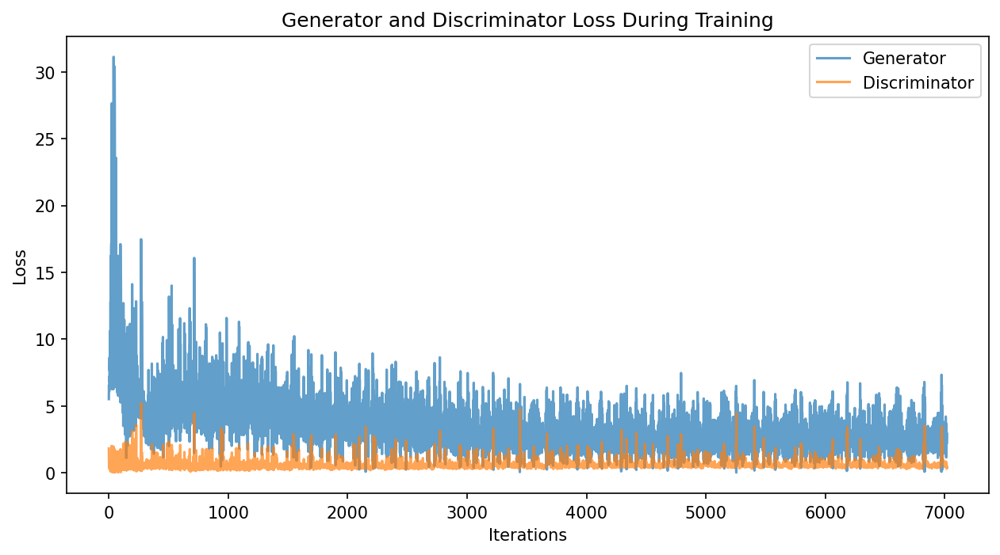
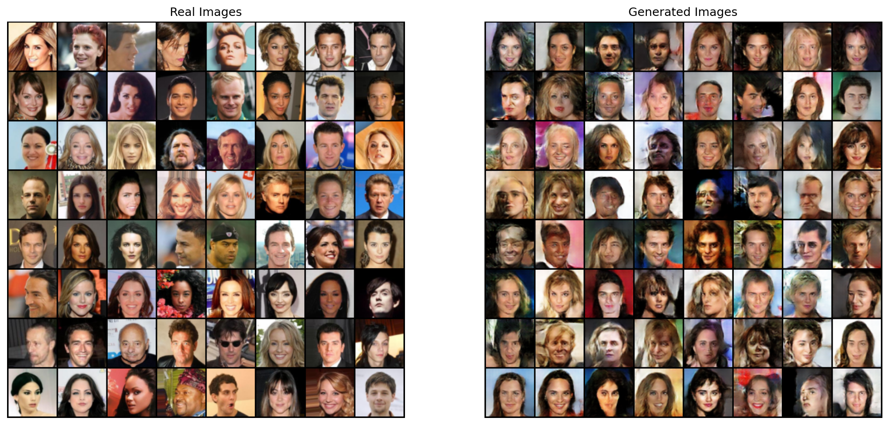
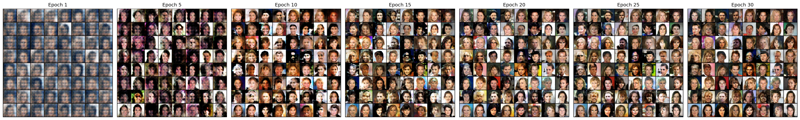

# Human Face Generation using DCGAN

This project trains a Deep Convolutional Generative Adversarial Network (DCGAN) to generate synthetic human faces from random noise using a subset of the CelebA dataset.

## Project structure

```text
face-generation-gan/
├── README.md
├── requirements.txt
├── notebook/
│   └── notebook84461d51eb (1).ipynb
├── results/
│   ├── loss_curves.png
│   ├── real_vs_generated.png
│   └── training_progress.png
├── samples/
│   ├── epoch_001.png
│   ├── epoch_005.png
│   ├── epoch_010.png
│   ├── epoch_015.png
│   ├── epoch_020.png
│   ├── epoch_025.png
│   └── epoch_030.png
└── models/
    └── generator.pth
```

## Dataset and preprocessing

The project uses the first 30,000 images from the sorted image filenames in CelebA. The dataset is not included in this repository.

- Dataset information: [CelebA](https://mmlab.ie.cuhk.edu.hk/projects/CelebA.html).
- Convert images to RGB.
- Apply a 178 × 178 center crop.
- Resize images to 64 × 64 pixels.
- Normalize pixel values to the range [-1, 1].

The notebook uses this Kaggle input directory:

```text
/kaggle/input/datasets/zuozhaorui/celeba/img_align_celeba/img_align_celeba
```

Set `DATA_DIR` to the directory containing the image files in your environment. Follow the dataset provider's terms when obtaining and using the data.

## Model architecture

The **Generator** transforms a random latent vector of shape `(100, 1, 1)` into a three-channel 64 × 64 image. It uses transposed convolutions, batch normalization, ReLU activations, and a final Tanh activation.

The **Discriminator** processes a three-channel 64 × 64 image and returns a real/fake score. It uses convolutions, LeakyReLU activations, batch normalization in intermediate blocks, and a final Sigmoid activation.

The models are trained alternately using binary cross-entropy loss. Generated images are detached when updating the Discriminator. The Generator is then trained to make the Discriminator classify its generated images as real.

## Training configuration

| Setting | Value |
|---|---|
| Training images | 30,000 |
| Image size | 64 × 64 RGB |
| Latent dimension | 100 |
| Batch size | 128 |
| Epochs | 30 |
| Optimizer | Adam |
| Learning rate | 0.0002 |
| Adam betas | (0.5, 0.999) |
| Loss | Binary cross-entropy |
| Random seed | 42 |
| Base feature maps | 64 for each model |

The training loop loads the resized images into device memory as uint8 tensors and normalizes each selected batch before use. The DataLoader defined earlier in the notebook is used to inspect training samples; the main training loop uses the preloaded tensor.

## Installation and execution

1. Install Python and a PyTorch build appropriate for your machine. For GPU execution, use the [official PyTorch installation instructions](https://pytorch.org/get-started/locally/) to select a compatible build.
2. Install the dependencies:

   ```bash
   pip install -r requirements.txt
   ```

3. Obtain CelebA and update `DATA_DIR` in the notebook.
4. Open the notebook:

   ```bash
   jupyter notebook "notebook/notebook84461d51eb (1).ipynb"
   ```

5. Run the cells in order. Training can overwrite outputs at the configured output paths.

The notebook writes to `/kaggle/working/samples/`, `/kaggle/working/results/`, and `/kaggle/working/`. Change these paths when running outside Kaggle. For the submission layout above, copy generated sample images into `samples/`, result figures into `results/`, and `generator.pth` into `models/`. These artifacts must be exported from the training environment; the current code does not automatically create them in the local project directory.

The notebook also saves `discriminator.pth` in `/kaggle/working/`. It can optionally be included in `models/`, but only Generator weights are needed for inference. The directory tree above describes the intended submission layout, rather than verification that all listed artifacts are present.

A CUDA GPU is recommended. The code selects CPU if CUDA is unavailable, but training time and available memory will depend on the machine. Reduce the dataset size or use a streaming DataLoader if preloading the images exceeds available memory.

Dependency versions were not recorded in the supplied notebook. The requirements file lists the required packages without claiming to reproduce the exact original environment.

## Saved results

### Training losses



### Real and generated images



### Progress during training



Samples are saved at epochs 1, 5, 10, 15, 20, 25, and 30. A fixed set of 64 latent vectors is used to make visual comparisons across epochs consistent.

## Observations and evidence

The updated notebook contains saved output reporting 30 completed epochs on an NVIDIA Tesla T4, with a reported elapsed training time of 1,283 seconds (approximately 21 minutes and 23 seconds). The final reported epoch-average losses are 0.7817 for the Discriminator and 2.6267 for the Generator. With 234 batches per epoch, the run records 7,020 training iterations.

The embedded sample figures show progression from noisy patterns to recognizable, varied faces. Some generated faces still have blur and artifacts around the eyes, teeth, face boundaries, and backgrounds. Loss values alone do not establish image quality or prove that training images were not memorized.

These observations are based on the notebook's saved outputs, rather than an independently repeated training run. The saved output reports that model weights were written; any separately distributed weight file should also be checked by loading it.

## Using the saved Generator

After running the notebook imports, defining the `Generator` class, and setting its model constants, use the following code with the path adjusted to your current working directory:

```python
device = torch.device("cuda" if torch.cuda.is_available() else "cpu")
generator = Generator(LATENT_DIM, NGF, NUM_CHANNELS).to(device)
state_dict = torch.load(
    "models/generator.pth", map_location=device, weights_only=True
)
generator.load_state_dict(state_dict)
generator.eval()

with torch.no_grad():
    noise = torch.randn(64, LATENT_DIM, 1, 1, device=device)
    generated = generator(noise).cpu()

vutils.save_image(
    generated,
    "generated_faces.png",
    nrow=8,
    normalize=True,
    value_range=(-1, 1),
)
```

If running from the `notebook/` directory, use `../models/generator.pth`. This inference example is provided as usage guidance; it was not executed during the notebook review.

## Limitations and possible improvements

- Training uses the first 30,000 sorted images rather than a random subset of the full dataset.
- The output resolution is limited to 64 × 64 pixels.
- Evaluation is visual; no FID score or systematic memorization check is included.
- Setting a seed does not guarantee identical results across devices and software versions.
- The notebook saves final model weights, but does not save periodic checkpoints with optimizer states for exact training resumption.
- Future work could add random subset selection, quantitative evaluation, nearest-training-image comparisons, and periodic resumable checkpoints.

## References

- [CelebA dataset](https://mmlab.ie.cuhk.edu.hk/projects/CelebA.html)

## Author
Gerges